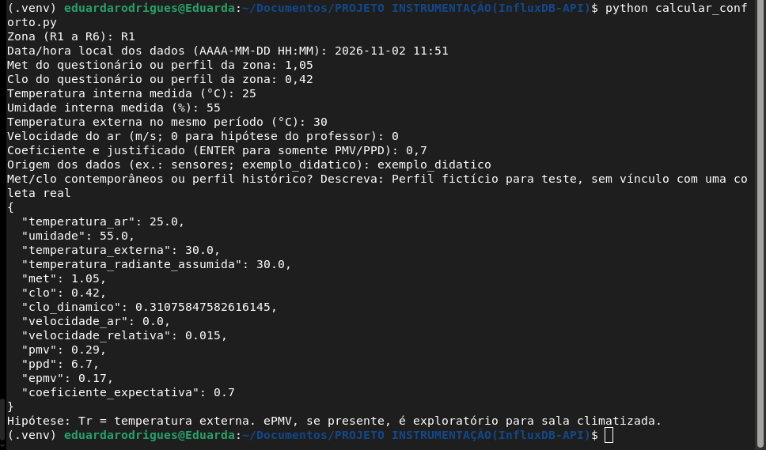

# Reprodução e Análise de Modelos de Conforto Térmico — PMV e PMVCE

Repositório independente dedicado à organização dos dados de conforto térmico do Laboratório de Arquitetura de Computadores — Bloco 4, da **Universidade Federal do Ceará (UFC), Campus Quixadá**, e à reprodução experimental de métodos de avaliação de conforto térmico.

O projeto parte dos dados e ferramentas desenvolvidos pelo Grupo 1, responsável pela caracterização da ocupação e da percepção térmica dos usuários do laboratório, e amplia essa base para apoiar estudos comparativos entre modelos de conforto térmico.

## Objetivos

- Organizar os dados de ocupação, taxa metabólica (`met`) e isolamento térmico das vestimentas (`clo`);
- Integrar os dados ao InfluxDB para armazenamento e consulta temporal;
- Calcular índices de conforto térmico a partir de dados ambientais;
- Estudar e reproduzir métodos de avaliação PMV e PMVCE;
- Comparar os resultados dos modelos com dados de percepção térmica dos usuários;
- Documentar hipóteses, limitações e procedimentos para garantir a reprodutibilidade dos experimentos.

## Origem e contexto dos dados

O projeto utiliza como ponto de partida o trabalho desenvolvido pelo Grupo 1, que realizou a caracterização da ocupação e da percepção térmica do laboratório.

O ambiente foi dividido em **seis zonas (R1–R6)**. Os questionários forneceram informações sobre atividades, vestimentas e percepção térmica dos usuários.

A base inicial contém **40 respostas válidas**, coletadas entre 28/09/2026 e 01/10/2026.

Os dados de caracterização são utilizados para estimar:

- **Taxa metabólica (`met`):** conforme as atividades relatadas;
- **Isolamento térmico das vestimentas (`clo`):** conforme as roupas utilizadas;
- Perfis de ocupação e distribuição dos respondentes;
- Sensação, satisfação e preferência térmica.

## Estado atual

| Etapa | Situação |
|---|---|
| Caracterização espacial em seis zonas | Realizada |
| Aplicação dos questionários | 40 respostas válidas |
| Estimativa de `met` e `clo` | Implementada |
| Integração com InfluxDB | Infraestrutura configurada |
| Scripts de ingestão | Simulados e validados |
| Cálculo de PMV, PPD e ePMV | Implementado |
| Reprodução experimental de PMV e PMVCE | Em desenvolvimento |
| Avaliação com dados ambientais reais | Pendente |
| Validação dos resultados na infraestrutura | Pendente |

**Atenção:** ePMV e PMVCE não são sinônimos. O cálculo de ePMV existente no código original não deve ser apresentado como implementação do PMVCE. A reprodução do método PMVCE deve seguir a metodologia do artigo de referência.

## Estrutura do repositório

```text
.
├── Setup_InfluxDB_Schedules-API/
│   ├── docker-compose.yml
│   ├── ingestao_automatizada.py
│   ├── ingestao_schedules.py
│   └── Questionário de Percepção Térmica — Salas de Aula UFC Quixadá.csv
├── docs/
│   └── imagens/
│       └── exemplo_calculo.png
├── .env.example
├── .gitignore
├── calcular_conforto.py
├── Grupo1_Schedules_met_clo_ASHRAE55.xlsx
├── Guia de Implantação e Acesso à API - Grupo 1.pdf
├── LEIA-ME.md
├── README.md
├── Relatório.pdf
└── requirements-conforto.txt
```

### Principais componentes

- `calcular_conforto.py`: cálculo de PMV, PPD e ePMV, com possibilidade de gravação dos resultados no InfluxDB.
- `Setup_InfluxDB_Schedules-API/ingestao_automatizada.py`: processamento e agrupamento das respostas do questionário.
- `Setup_InfluxDB_Schedules-API/ingestao_schedules.py`: organização de registros de referência extraídos do relatório.
- `Setup_InfluxDB_Schedules-API/docker-compose.yml`: configuração dos serviços InfluxDB, Grafana e Mosquitto.
- `.env.example`: modelo de configuração das variáveis de ambiente, sem credenciais reais.
- `.gitignore`: arquivos e diretórios que não devem ser versionados.
- `requirements-conforto.txt`: dependências Python do projeto.
- `docs/imagens/`: imagens utilizadas na documentação.

O arquivo `.env` contém as credenciais locais e não deve ser enviado ao repositório.

## Zonas

O laboratório foi dividido em seis regiões, identificadas como **R1, R2, R3, R4, R5 e R6**.


A base de questionários recebida contém respostas das zonas **R1, R2, R5 e R6**.

A ausência de respostas em R3 e R4 não comprova, por si só, que essas zonas estavam desocupadas.

## Coleta dos questionários

Os questionários foram aplicados entre **28/09/2026 e 01/10/2026**, totalizando **40 respostas válidas**.

Os períodos de referência utilizados na organização inicial são:

- **Manhã — 10h**
- **Tarde 1 — 13h30**
- **Tarde 2 — 15h30**

Os horários de envio das respostas não coincidem necessariamente com esses horários de referência.

### Agrupamento e interpretação dos dados

Na versão inicial dos scripts:

- `ingestao_automatizada.py` agrupa as respostas por zona, data e hora inteira;
- `ingestao_schedules.py` utiliza valores consolidados nos horários de referência, associados a uma data-base.

Essas duas formas de organização precisam ser harmonizadas antes de serem utilizadas como um único conjunto de schedules. Um histórico de coleta e um perfil representativo devem ser identificados separadamente.

No script automático, o campo `ocupacao` corresponde à contagem de respostas do agrupamento. Esse valor só pode ser interpretado como número total de ocupantes se houver evidência de que todas as pessoas presentes responderam ao questionário.

## Schedules e integração entre grupos

Os schedules reúnem informações de ocupação, `met` e `clo`, associadas às zonas e aos períodos analisados.

A integração entre grupos deve utilizar os dados disponibilizados pela API do InfluxDB. A planilha e o relatório permanecem como documentação da etapa de caracterização.

É necessário distinguir:

- **Dados históricos:** associados às datas e aos horários reais da coleta;
- **Perfis representativos:** valores consolidados utilizados para representar condições típicas de ocupação.

## Ingestão dos schedules

O projeto disponibiliza dois scripts para organizar os dados de ocupação, taxa metabólica (`met`) e isolamento térmico das vestimentas (`clo`).

Os dois utilizam a medição `schedules_r1_r6` no InfluxDB, diferenciando os registros pela tag `origem`.

### 1. Dados do questionário

O script `ingestao_automatizada.py` processa as 40 respostas do questionário e agrupa os registros por:

- Zona do laboratório;
- Data da coleta;
- Hora inteira.

Para cada agrupamento, são calculadas as médias de `met` e `clo`, além da contagem de respostas.

A tag `origem` recebe o valor `questionario`.

**Resultado da execução atual:** 20 agrupamentos preparados.

### 2. Dados de referência do relatório

O script `ingestao_schedules.py` utiliza nove registros consolidados extraídos da Tabela 1 do relatório do Grupo 1.

Os registros são associados à data-base de 30/09/2026 e aos horários de referência de 10h, 13h30 e 15h30.

A tag `origem` recebe o valor `relatorio`.

**Resultado da execução atual:** nove registros preparados.

Esses registros são dados de referência e não devem ser confundidos com as respostas individuais agrupadas do questionário.

### 3. Modo de simulação

Por segurança, os dois scripts executam em modo de simulação por padrão. Nesse modo, os registros são preparados e apresentados no terminal, sem gravação no InfluxDB.

Na raiz do repositório:

```bash
python Setup_InfluxDB_Schedules-API/ingestao_automatizada.py
```

```bash
python Setup_InfluxDB_Schedules-API/ingestao_schedules.py
```

### 4. Gravação explícita no InfluxDB

A gravação exige a opção `--gravar`:

```bash
python Setup_InfluxDB_Schedules-API/ingestao_automatizada.py --gravar
```

```bash
python Setup_InfluxDB_Schedules-API/ingestao_schedules.py --gravar
```

Antes de habilitar a gravação, verifique os registros apresentados na simulação, confirme a configuração do banco e avalie se os dados correspondem ao cenário que deseja armazenar.

### 5. Interpretação da ocupação

No script do questionário, o campo `ocupacao` representa a quantidade de respostas recebidas em cada agrupamento de zona, data e hora.

Esse valor não representa necessariamente a quantidade total de pessoas presentes no laboratório, pois nem todos os ocupantes precisam ter respondido ao questionário.

## Cálculo dos índices de conforto térmico

O script `calcular_conforto.py` calcula:

- **PMV:** voto médio previsto de sensação térmica;
- **PPD:** percentual previsto de insatisfeitos associado ao PMV;
- **ePMV:** extensão do PMV com fator de expectativa e correção metabólica, calculada quando o coeficiente de expectativa é informado.

O PPD retornado corresponde ao **PMV convencional**, não ao ePMV.

### Entradas necessárias

| Entrada | Unidade ou formato | Origem |
|---|---|---|
| Zona | R1 a R6 | Mapeamento do laboratório |
| Data e horário | `AAAA-MM-DD HH:MM` | Período analisado, no fuso de Fortaleza |
| Taxa metabólica | met | Questionários |
| Isolamento das roupas | clo | Questionários |
| Temperatura interna | °C | Medição informada manualmente; integração com sensores pendente |
| Umidade relativa interna | % | Medição informada manualmente; integração com sensores pendente |
| Temperatura externa | °C | Dado externo correspondente ao período, informado manualmente |
| Velocidade ambiente do ar | m/s | Medição ou hipótese identificada, informada manualmente |
| Coeficiente de expectativa | Adimensional | Definição metodológica justificada |

O programa também solicita a origem dos dados e a descrição do perfil de `met` e `clo` utilizado.

### Hipóteses e limitações

Para o exercício, foram adotadas as seguintes simplificações:

- **Temperatura radiante média igual à temperatura externa**, conforme a orientação recebida. Essa substituição é uma hipótese do exercício, não uma medição da temperatura radiante.
- **Velocidade ambiente inicialmente igual a zero**, como hipótese de cálculo. O fluxo dos aparelhos de ar-condicionado pode alterar a velocidade junto aos ocupantes e deve ser avaliado.

A biblioteca realiza os ajustes de velocidade relativa e isolamento dinâmico. Assim, esses valores podem diferir da velocidade ambiente e do `clo` informados.

O ePMV utilizado foi desenvolvido para ambientes não climatizados em climas quentes. Sua aplicação à sala com ar-condicionado é tratada como **exploratória**, devendo ser justificada na metodologia.

O coeficiente de expectativa não deve ser escolhido apenas para produzir um resultado desejado.

### Correspondência temporal

As medições ambientais devem corresponder à zona e ao período que se pretende avaliar.

Se os valores históricos de `met` e `clo` forem utilizados com medições de outro período, o resultado deve ser identificado como avaliação de um **perfil representativo**, e não como reconstrução das condições da coleta original.

Quando utilizados `met` e `clo` médios, o resultado caracteriza esse perfil médio; ele não equivale necessariamente à média dos índices calculados individualmente para os respondentes.

## Infraestrutura e banco de dados

O projeto utiliza Docker Compose para disponibilizar três serviços:

| Serviço | Finalidade | Porta |
|---|---|---:|
| InfluxDB 2.7 | Armazenamento de séries temporais | 8086 |
| Grafana | Visualização e dashboards | 3000 |
| Mosquitto | Broker de mensagens MQTT | 1883 e 9001 |

### Configuração das credenciais

As credenciais e variáveis de ambiente são armazenadas no arquivo `.env`, localizado na raiz do repositório.

Crie o arquivo a partir do modelo:

```bash
cp .env.example .env
```

Edite o arquivo `.env` e preencha os valores necessários:

- `INFLUX_URL`: endereço do InfluxDB;
- `INFLUX_TOKEN`: token de acesso ao InfluxDB;
- `INFLUX_PASSWORD`: senha inicial do usuário administrador;
- `INFLUX_ORG`: organização do InfluxDB;
- `INFLUX_BUCKET`: bucket utilizado para armazenar os dados;
- `GRAFANA_PASSWORD`: senha do administrador do Grafana.

**Nunca compartilhe o arquivo `.env` ou envie suas credenciais ao GitHub.**

### Inicialização dos serviços

Na raiz do repositório, execute:

```bash
docker compose --env-file .env \
-f Setup_InfluxDB_Schedules-API/docker-compose.yml up -d
```

Para verificar os serviços:

```bash
docker compose --env-file .env \
-f Setup_InfluxDB_Schedules-API/docker-compose.yml ps
```

Para verificar a saúde do InfluxDB:

```bash
curl -sS http://localhost:8086/health
```

### Acesso às interfaces

- InfluxDB: http://localhost:8086
- Grafana: http://localhost:3000

### Encerramento dos serviços

```bash
docker compose --env-file .env \
-f Setup_InfluxDB_Schedules-API/docker-compose.yml down
```

O comando `down` encerra e remove os contêineres, mas preserva o volume de dados do InfluxDB. Não utilize `down -v` se desejar preservar os dados armazenados.

## Instalação e execução

Os comandos devem ser executados na raiz do repositório, em um terminal Linux.

### 1. Criar e ativar o ambiente virtual

```bash
python3 -m venv .venv
source .venv/bin/activate
```

### 2. Instalar as dependências

```bash
python -m pip install -r requirements-conforto.txt
```

### 3. Executar o cálculo de conforto térmico

```bash
python calcular_conforto.py
```

O programa solicita os parâmetros ambientais e pessoais pelo terminal.

Nos campos numéricos, informe somente o número, sem unidade. O programa aceita ponto ou vírgula como separador decimal.

Para calcular somente PMV e PPD, pressione **Enter** no campo do coeficiente de expectativa.

A gravação no InfluxDB é opcional e depende da utilização explícita da opção `--gravar`, além da configuração correta das credenciais no `.env`.

## Exemplo de funcionamento

Foi realizado um teste com os seguintes **valores fictícios**:

| Entrada | Valor |
|---|---:|
| Met | 1,05 |
| Clo | 0,42 |
| Temperatura interna | 25 °C |
| Umidade relativa | 55% |
| Temperatura externa assumida como radiante | 30 °C |
| Velocidade ambiente | 0 m/s |
| Coeficiente de expectativa | 0,7 |

Resultados obtidos com `pythermalcomfort==4.6.2`:

| Índice | Resultado |
|---|---:|
| PMV | 0,29 |
| PPD | 6,7% |
| ePMV | 0,17 |



**Esses resultados demonstram a execução do programa e não representam medições ou conclusões sobre o conforto real do laboratório.**

O coeficiente `0,7` foi utilizado somente para o teste.

## Gravação dos índices no InfluxDB

A gravação dos resultados de conforto térmico é opcional e ocorre somente quando o programa é executado com o argumento `--gravar`.

Os resultados são armazenados no measurement `conforto_calculado`, separado dos dados de ocupação e dos perfis térmicos armazenados em `schedules_r1_r6`.

### Dados registrados

O programa registra:

- **Identificação do cenário:** zona, método, hipótese para temperatura radiante, velocidade do ar e coeficiente de expectativa;
- **Origem e perfil:** procedência dos dados e descrição dos valores de `met` e `clo`;
- **Rastreabilidade:** versão da biblioteca `pythermalcomfort`;
- **Entradas do cálculo:** temperatura do ar, umidade, temperatura externa, temperatura radiante assumida, `met`, `clo`, `clo` dinâmico, velocidade do ar e velocidade relativa;
- **Resultados:** PMV e PPD;
- **Resultado opcional:** ePMV e coeficiente de expectativa, quando informados.

O timestamp é registrado em milissegundos, considerando o fuso horário `America/Fortaleza`.

### Configuração da conexão

As credenciais e configurações são carregadas automaticamente do arquivo `.env`, localizado na raiz do repositório.

Não é necessário exportar as variáveis manualmente no terminal. As variáveis utilizadas são:

- `INFLUX_URL`;
- `INFLUX_TOKEN`;
- `INFLUX_ORG`;
- `INFLUX_BUCKET`.

O arquivo `.env` contém credenciais privadas e não deve ser versionado ou compartilhado.

### Execução com gravação

Com o ambiente virtual ativado, o InfluxDB em execução e os dados conferidos, utilize:

```bash
python calcular_conforto.py --gravar
```

Sem o argumento `--gravar`, o programa realiza o cálculo e apresenta os resultados no terminal, sem gravá-los no banco.

**Importante:** exemplos didáticos são bloqueados para gravação. Os resultados também devem ser interpretados considerando as hipóteses adotadas, especialmente a utilização da temperatura externa como aproximação da temperatura radiante.

### Estado da integração

A conexão com o InfluxDB, a autenticação e a identificação do bucket foram verificadas. A gravação e a consulta de resultados reais no measurement `conforto_calculado` ainda precisam de validação ponta a ponta.

## Próximas etapas

### Infraestrutura e dados
- Harmonizar o agrupamento temporal dos schedules;
- Confirmar a interpretação do campo de ocupação, distinguindo respostas ao questionário de ocupação real do laboratório;
- Obter medições ambientais identificadas por zona, data e horário;
- Integrar a leitura dos dados ambientais ao fluxo de processamento;
- Validar a gravação e a consulta dos resultados no InfluxDB.

### Reprodução experimental do artigo
- Estudar e documentar a metodologia de cálculo do PMV e do PMVCE apresentada no artigo de referência;
- Implementar o PMVCE de acordo com a metodologia do artigo, sem confundi-lo com o ePMV já existente;
- Reproduzir os critérios de filtragem e seleção dos dados utilizados pelos autores;
- Executar os experimentos com as mesmas condições e parâmetros descritos no artigo;
- Comparar os resultados obtidos com os valores publicados;
- Documentar diferenças, limitações e possíveis causas de divergência.

### Análise e validação
- Avaliar a influência da velocidade do ar e das demais variáveis ambientais;
- Comparar os índices calculados com as respostas de percepção térmica, considerando a correspondência temporal;
- Consolidar tabelas, gráficos e métricas para análise dos modelos;
- Atualizar a documentação com a metodologia, os experimentos e os resultados obtidos.

## Referências

- TARTARINI, Federico; SCHIAVON, Stefano. **Comparative analysis of PMV Models accuracy implemented in the ISO 7730:2005 and ASHRAE 55:2023**. *Building and Environment*, v. 275, art. 112766, 2025. DOI: [10.1016/j.buildenv.2025.112766](https://doi.org/10.1016/j.buildenv.2025.112766).
- **ANSI/ASHRAE Standard 55-2023 — Thermal Environmental Conditions for Human Occupancy.**
- **ISO 7730:2005 — Ergonomics of the thermal environment.**
- [Documentação do pythermalcomfort](https://pythermalcomfort.readthedocs.io/).
- [Implementação do ePMV no pythermalcomfort](https://pythermalcomfort.readthedocs.io/en/stable/_modules/pythermalcomfort/models/pmv_e.html).
- [CBE Thermal Comfort Tool](https://comfort.cbe.berkeley.edu/).
- Questionários, tabelas de conversão e documentos metodológicos utilizados pelo Grupo 1.

## Equipe

- Davi Medeiros
- Maria Eduarda
- Nathalia Lima
- Pablo Brandão

**Universidade Federal do Ceará — Campus Quixadá**
**Engenharia de Computação — 2026**
